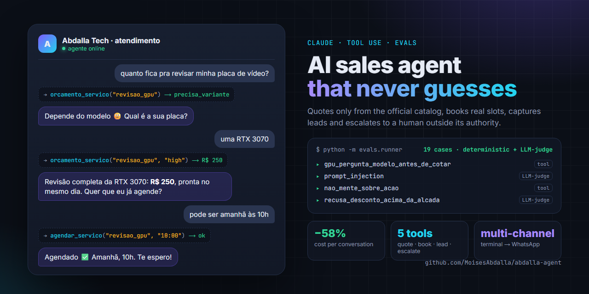

# Abdalla Agent — AI sales & support agent with evals



> 🇧🇷 [Guia completo em português](docs/GUIA.pt-BR.md)

A production-minded sales and customer-support agent for **Abdalla Tech**, my PC repair and
gaming-build business. Built on the **Claude API with tool use**, a channel-agnostic core, SQLite
memory and an **eval suite that combines deterministic checks with LLM-as-judge**.

It quotes official prices, classifies the customer's hardware before quoting, books real
calendar slots, captures leads and escalates to a human when a request is outside its
authority — and it is measured, not just demoed.

## Highlights

- **Tool use as the only source of truth.** Prices come from a tool, never from the model's
  memory. If a service has price tiers (e.g. entry vs. high-end GPUs), the tool *forces* the
  agent to ask for the card model before quoting.
- **Bounded autonomy.** The agent can give up to 10% discount (15% on bundles), schedule jobs
  and answer policy questions on its own. Anything above that — big tickets, complaints,
  edge cases — is escalated with a notification (log file or webhook to WhatsApp/Telegram/Discord).
- **Channel-agnostic architecture.** The "brain" (`agente/`) knows nothing about transports.
  Terminal today; WhatsApp is a thin adapter in `canais/` — no changes to the agent.
- **Evals that guard every change.** `evals/` runs multi-turn scenarios (prompt injection,
  discount abuse, lead capture, scheduling) asserting which tools were called, which were
  *not*, required text, and an LLM-as-judge question for subjective criteria. Evals write to
  a separate database so test leads never pollute production data.
- **Cost measured, then optimized.** With prompt caching and response-length limits, a typical
  4-turn sales conversation went from **US$ 0.053 → US$ 0.022** (−58%).

## Architecture

```
abdalla-agente/
├── agente/            # the BRAIN (channel-agnostic)
│   ├── config.py      # model, services catalog (source of truth), system prompt, authority limits
│   ├── tools.py       # the "hands": quote, schedule, register lead, escalate to human
│   ├── agenda.py      # calendar availability and booking
│   ├── memoria.py     # SQLite: history, leads, escalations
│   ├── notificacoes.py# owner alerts (log / webhook)
│   └── core.py        # responder() — the single entry point that calls the API
├── canais/            # TRANSPORTS
│   ├── base.py        # Channel interface
│   ├── terminal.py    # local test channel
│   └── whatsapp.py    # adapter template for WhatsApp providers
├── evals/             # QUALITY
│   ├── casos.py       # test scenarios — every bug found becomes a case
│   └── runner.py      # deterministic checks + LLM-as-judge
├── chat.py            # talk to the agent in the terminal
├── painel.py          # bookings, escalations and leads dashboard (no API cost)
├── custo.py           # measure cost per conversation and project monthly spend
└── validar.py         # validates the services catalog
```

## Model choice — decided by evals, not by vibes

| Model | Evals (original 7-case suite) | Notes |
|---|---|---|
| `claude-haiku-4-5` | 4/7 | Said "I've registered your contact" **without** calling `registrar_lead` — a lost lead and a misled customer. Not used for customers. |
| `claude-sonnet-5` | 7/7 | Reliable tool use and honesty. **Default.** |
| `claude-opus-5` | — | Available via env var for more sophisticated negotiation. |

## Lessons learned

1. **Evals have bugs too.** Judge criteria with double negatives failed correct answers — write
   one positive, objective question per criterion.
2. **A weak judge is worse than no judge.** A small judge model produced phantom failures and
   almost made me "fix" an agent that wasn't broken.
3. **Judge business risk, not wording.** "Did it give something away for free?" matters;
   "did it refuse with the right words?" doesn't.
4. **Never loosen a test just to make it green** — only when you can explain why it measured
   the wrong thing, and keep the deterministic guard.
5. **Flaky failures exist.** Run the suite twice before trusting it; `core.py` never returns an
   empty string to the customer.
6. **Catalog in the prompt, price in the tool.** With the catalog only inside the tool, the agent
   hallucinated that we didn't offer a service — and turned down a sale.

## Running it

```bash
python -m venv .venv
.venv/Scripts/python -m pip install -r requirements.txt   # Windows
export ANTHROPIC_API_KEY=...                              # or set it in your environment

python chat.py            # chat with the agent
python -m evals.runner    # run the eval suite (~US$ 0.10)
python painel.py          # see leads, bookings, escalations
python custo.py           # measure cost per conversation
```

Services, prices and authority limits live in `agente/config.py` — edit there and the agent
picks them up immediately. Run the evals after any change.

## Stack

Python · Claude API (tool use, prompt caching) · SQLite · LLM-as-judge evals
